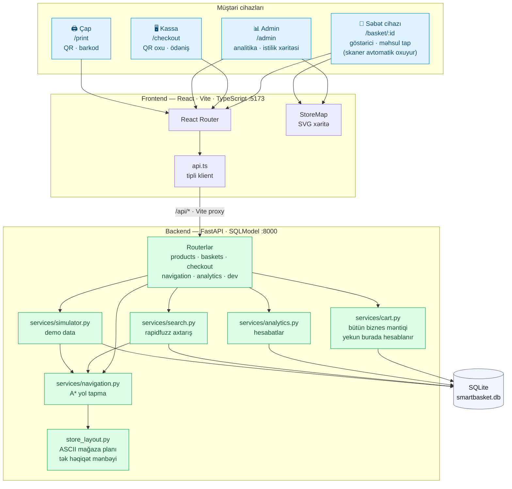
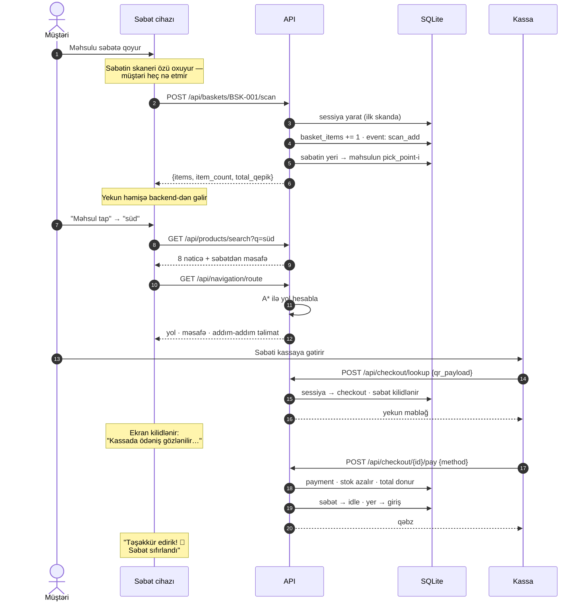
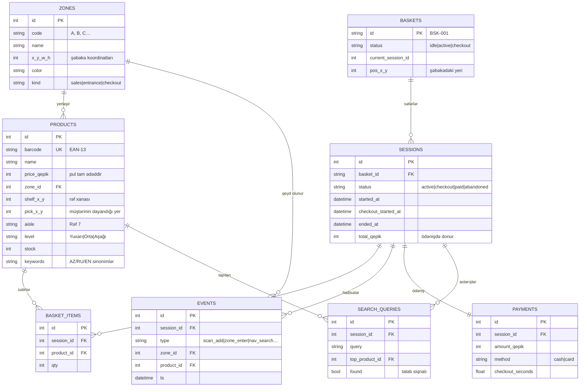

# Smart Basket — arxitektura

Bu sənəd sistemin necə işlədiyini üç diaqramla izah edir: komponentlər,
alış-veriş axını və verilənlər modeli.

---

## 1. Sistem arxitekturası

Hər şey bir maşında işləyir. Frontend `/api` sorğularını Vite proxy ilə
backend-ə ötürür — ona görə telefon yalnız frontend ünvanını bilməlidir və
CORS problemi olmur.



**Qeyd:** məhsulun yeri və ona gedən yol heç vaxt AI ilə müəyyən edilmir.
Yer bazada koordinat kimi saxlanılır, yol isə `navigation.py`-dəki A\*
alqoritmi ilə hesablanır — deterministik, oflayn və pulsuz.

---

## 2. Alış-veriş axını

Səbət fiziki obyektdir (daimi ID), sessiya isə bir alış-veriş səfəridir.
Ödəniş sessiyanı bitirir və səbəti `idle` edir — "sıfırlanma" budur.



---

## 3. Verilənlər modeli



---

## 4. Mağaza planı

Mağaza `backend/app/store_layout.py` faylında ASCII şəbəkə kimi təsvir olunub —
1 simvol = 1 m². Bu, bütün sistemin tək həqiqət mənbəyidir: xəritə, yol tapma,
məhsul yerləri və istilik xəritəsi hamısı bu fayldan törəyir.

```
##############################
#AAAAAAAAABBBBBBBBBBCCCCCCCCC#   A  Meyvə-Tərəvəz      #  divar
#............................#   B  Çörək              .  keçid
#............................#   C  Süd məhsulları     @  giriş
#D..FF..GG..HH..II..JJ..KK..C#   D  Ət və Toyuq        $  kassa
#D..FF..GG..HH..II..JJ..KK..C#   F  Bakaleya
#D..FF..GG..HH..II..JJ..KK..C#   G  Çay-Qəhvə
#D..FF..GG..HH..II..JJ..KK..C#   H  İçkilər
#D..FF..GG..HH..II..JJ..KK..C#   I  Şirniyyat
#D..FF..GG..HH..II..JJ..KK..C#   J  Təmizlik
#D..FF..GG..HH..II..JJ..KK..C#   K  Uşaq məhsulları
#D..FF..GG..HH..II..JJ..KK..C#
#D..FF..GG..HH..II..JJ..KK..C#
#D..FF..GG..HH..II..JJ..KK..C#
#............................#
#............................#
#............................#
#@........$...$...$..........#
##############################
```

Başqa mağazanın planını çəkmək üçün yalnız bu faylı redaktə etmək kifayətdir.
Qayda: hər rəf xanasının ən azı bir qonşu keçid xanası olmalıdır — əks halda
həmin məhsula çatmaq mümkün olmazdı. Bu, testlə yoxlanılır.
